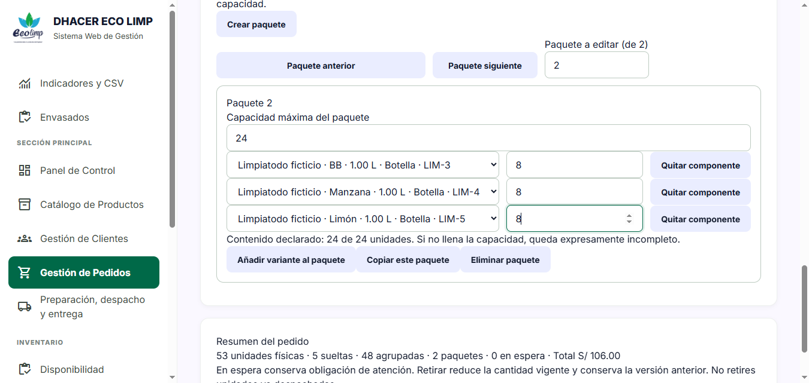
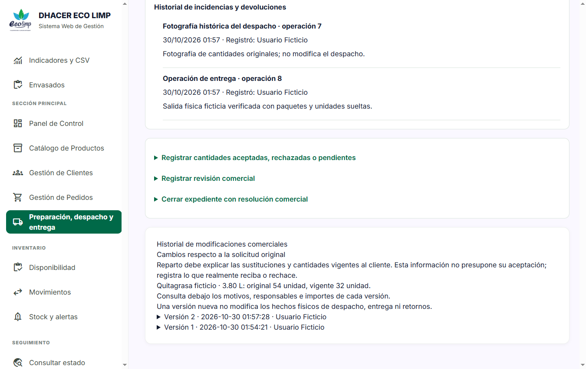
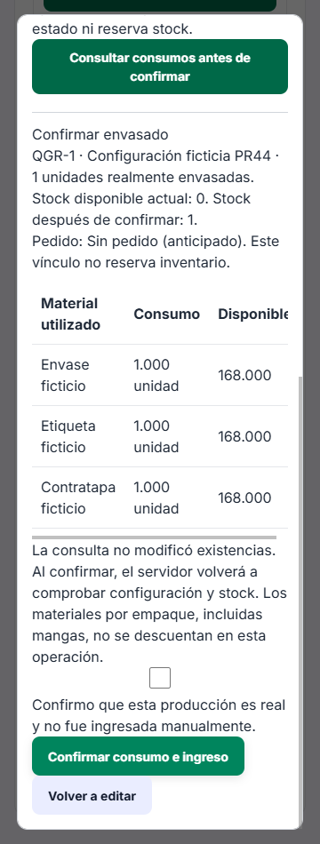
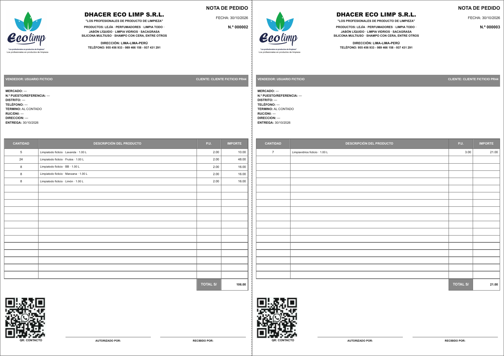
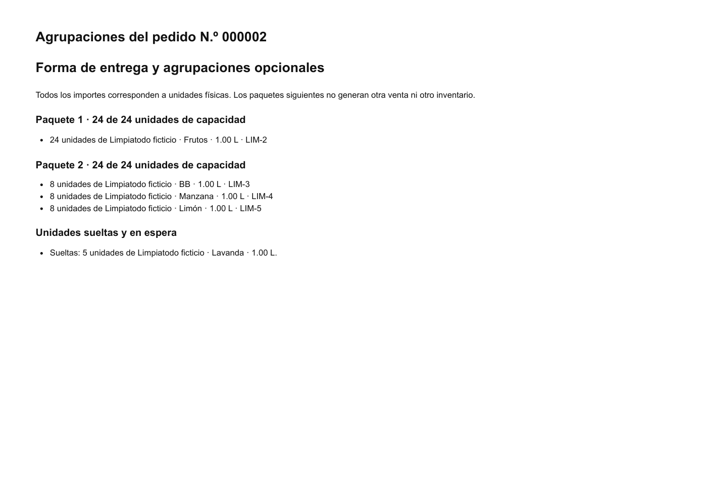

# Evidencia del PR45: ventas por unidades

30/10/2026. Datos exclusivamente ficticios. MySQL 8.4.3 independiente en puerto 3347, checkout sin `.env` operativo y servidor protegido en 127.0.0.1:8026. No se usaron ni limpiaron las bases existentes del proyecto.

Selenium ejecutó los seis escenarios completos: **6 aprobados / 518,67 segundos**. Se comprobaron anchos efectivos 360, 390, 768, 1024 y 1366 px, sin desborde horizontal del documento; las tablas anchas conservan desplazamiento interno. Consola sin errores graves.

- 53 unidades a S/2: 5 Lavanda sueltas, 24 Frutos agrupadas y 24 mixtas (8 BB, 8 Manzana, 8 Limón); copia independiente y total S/106.
- Salidas de 29 y 24; stock por aroma 95/76/92/92/92. Rechazo y recepción no cambian esos saldos. Aprobar una unidad apta lleva BB a 93; la dañada no se reincorpora.
- Quitagrasa: registro de 54 sin existencias, envasado real de 32 y consumo de 32 envases, etiquetas y contratapas. Cada material pasa de 200 a 168. Manga permanece en 100. Edición comercial a 32 mantiene esos consumos y recalcula S/324 a S/192; salida física de 32 deja stock 0.
- Pedido normal histórico de dos empaques: S/48 original conservado; no se convierte su precio a tarifa por unidad.
- Modal en 360/390 px: vista previa, Escape y cierre sin producción ni movimientos nuevos. Agrupaciones ya despachadas conservan su fotografía y controles no editables.
- PDF revisado mediante render: dos páginas A4 horizontales, primera con notas distintas 000002 y 000003; segunda con el anexo. No hay páginas en blanco. No sustituye impresión física.

[Resultados y saldos por etapa](resultados.json), [registro Selenium](selenium-integral.txt), [PDF](notas-y-agrupaciones-pr45.pdf).

Las credenciales, cookies, manifiestos privados, archivos SQL y logs completos del servidor no se publican. No equivale a UAT con trabajadores ni a otra campaña k6/ZAP.
