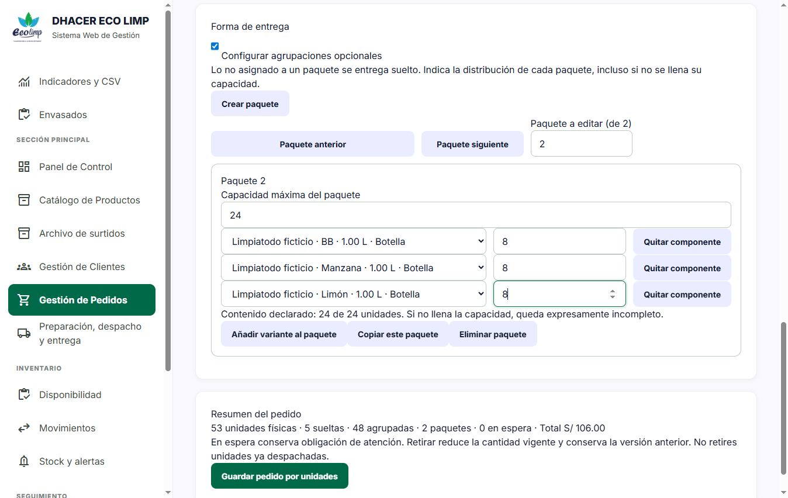
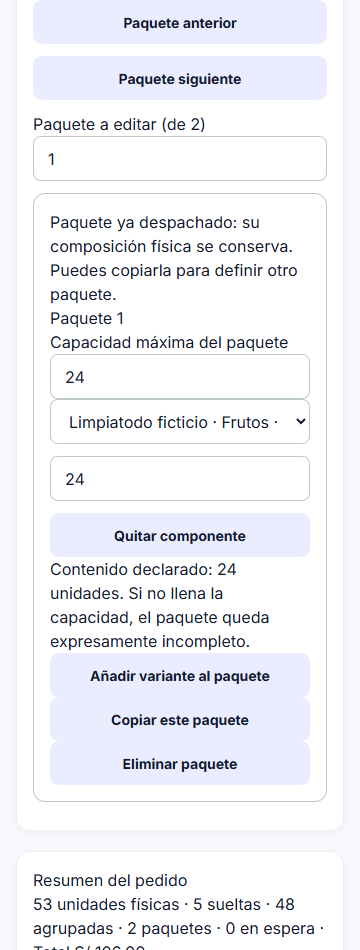
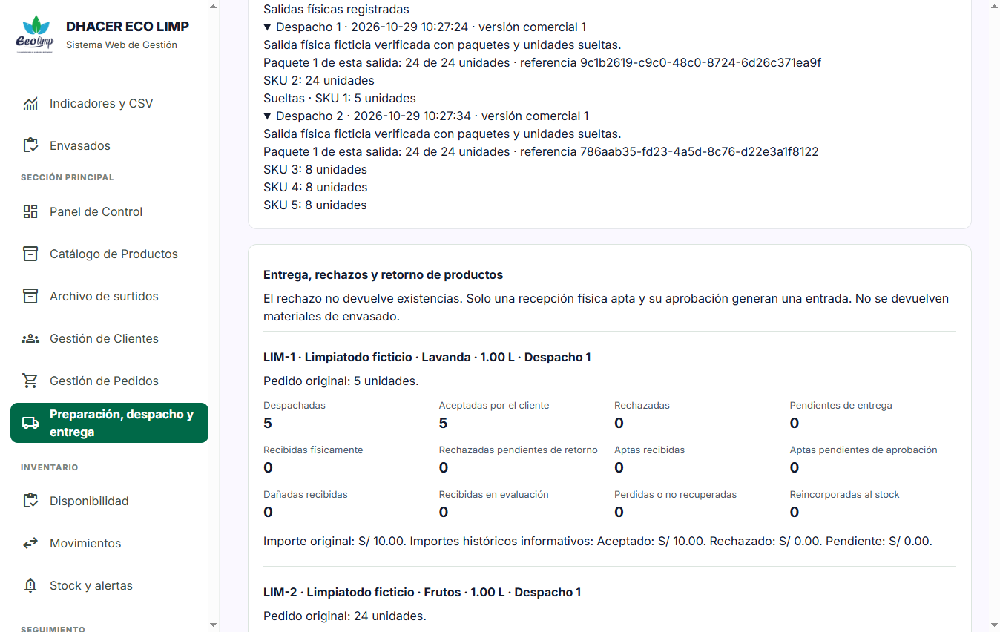
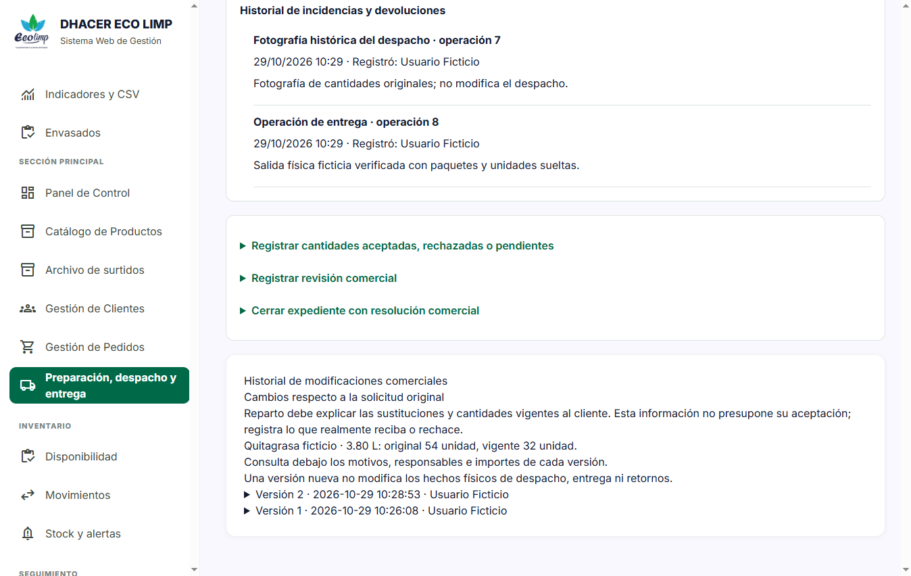
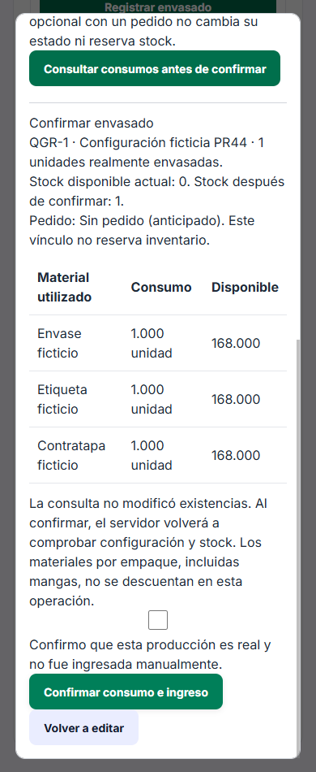
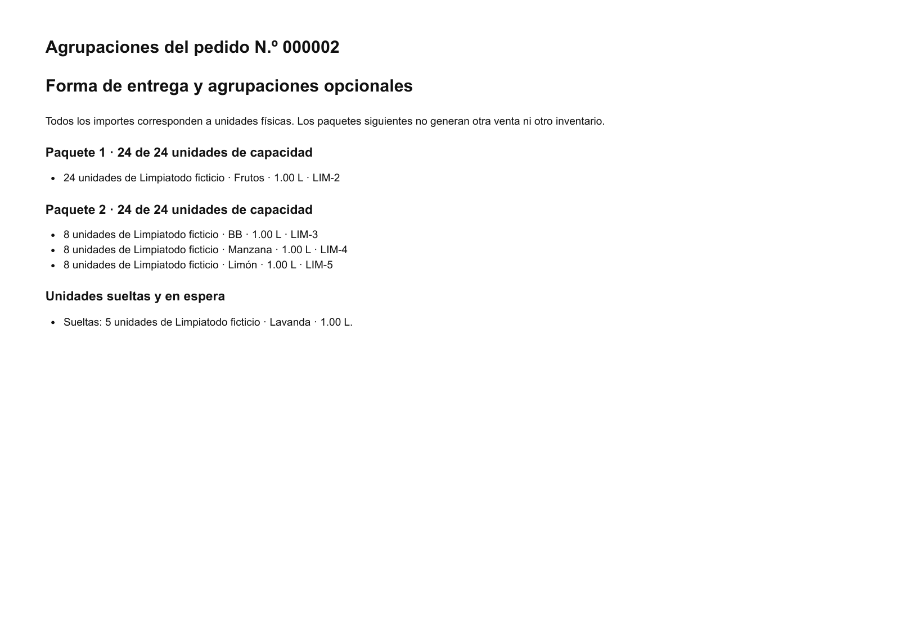

# Evidencia funcional y visual del PR44

29/10/2026. **Datos exclusivamente ficticios**. Chrome 146, Selenium 4.52.0 y
pytest 9.2.0 sobre Windows, servidor local 127.0.0.1:8026. MySQL 8.4.3 independiente
en 3347, UUID y directorio verificados, cuenta HTTP limitada a la base visual.
El checkout no contiene el `.env` operativo. No se utilizaron las bases protegidas.

## Ejecuciones reales

- Campaña principal: **5/5**, 334,44 segundos, casos 01 al 05.
- Repetición focalizada: **2/2**, 164,65 segundos, caso 05 con anchos efectivos
  comprobados tras cada navegación y nuevo caso 06 de modal, agrupaciones e historial.
- Son **seis escenarios distintos**, no siete. Los otros cuatro casos ya estaban
  aprobados; no se desactivaron para obtener un resultado positivo.
- El primer intento falló porque el propio guion pulsaba «Añadir unidades» en
  lugar del botón de envío. No guardó el primer pedido. Se corrigió el selector
  y se repitió la campaña completa. No se cambiaron reglas de negocio para ello.
- Consola: sin errores graves de JavaScript. Viewports 360, 390, 768, 1024 y
  1366 px, sin desborde horizontal del documento. Las tablas anchas conservan
  desplazamiento dentro de su contenedor.

Los comandos y controles están en [Selenium](../../../../tests/Selenium/README_redisenio.md).
Los resultados numéricos y SHA-256 de estos archivos están en
[el resumen JSON](../redisenio_pr44.json). Los logs completos y credenciales privadas
permanecen fuera de Git; no se publican volcados SQL ni cookies.

## Pedido por unidades y distribución

53 unidades a S/2, total **S/106**: 5 Lavanda sueltas, paquete de 24 Frutos,
paquete mixto de 8 BB, 8 Manzana y 8 Limón. Se copió el primer paquete y se
modificó el segundo independientemente. No se sumó otro precio por agrupar.

El editor móvil muestra un paquete a la vez y conserva la fotografía de los ya
despachados. No obliga a llenar una capacidad ni permite alterar lo enviado.

## Inventario comprobado por etapa

Cada aroma comenzó con 100 unidades terminadas. Las cantidades siguientes
proceden de snapshots de lectura del servidor verificado, no de totales del DOM.

| Etapa | Lavanda | Frutos | BB | Manzana | Limón | Total de los cinco SKU |
|---|---:|---:|---:|---:|---:|---:|
| Antes de despachar | 100 | 100 | 100 | 100 | 100 | 500 |
| Primera salida: 24 Frutos y 5 sueltas | 95 | 76 | 100 | 100 | 100 | 471 |
| Segunda salida: paquete mixto de 24 | 95 | 76 | 92 | 92 | 92 | 447 |
| Rechazo de 2 BB | 95 | 76 | 92 | 92 | 92 | 447 |
| Recepción: 1 apta y 1 dañada | 95 | 76 | 92 | 92 | 92 | 447 |
| Aprobación de 1 apta | 95 | 76 | 93 | 92 | 92 | 448 |

Se aceptaron 51 unidades y se rechazaron 2. Reparto registró resultado y recepción
sin controles de aprobación ni rectificación. Operaciones aprobó la única apta.
La dañada no generó entrada. El importe comercial original siguió siendo S/106;
no se creó un reembolso ni se modificó un pago.

## Envasado y edición comercial

Quitagrasa, sin variantes, se solicitó y confirmó por 54 unidades con stock cero.
Preparación confirmó 32 realmente envasadas desde el modal: stock 0 → 32 y
envases, etiquetas y contratapas ficticios 200 → 168 cada uno. La manga sin
consumo configurado conservó 100 metros.

Operaciones redujo 54 → 32 con motivo; el original quedó en la versión anterior,
el importe vigente fue S/192 y no se repitió el envasado. El despacho posterior
descontó 32, dejando stock cero y los mismos materiales en 168.

En la revisión móvil se creó otro pedido ficticio de una unidad únicamente para
consultar el modal. La consulta mostró consumos y se cerró con Escape **sin
confirmar**: inventarios, materiales y los 11 movimientos permanecieron iguales.
El vínculo con un pedido es opcional y no reserva existencias.

El pedido histórico de control conservó modelo anterior, total S/48 y stock 60.
Su formulario se revisó sin guardarlo. Las ediciones históricas explícitas,
sus importes y conservación de movimientos también están cubiertos por las
regresiones Laravel y la conservación de datos en MySQL.

## Impresión revisada

[Abrir las notas y su anexo en PDF](notas-y-agrupaciones-pr44.pdf).

Resultado: **dos páginas A4 horizontales**. Primera: dos notas, S/106 y S/21.
Segunda: anexo de los dos paquetes y las cinco unidades sueltas, sin añadir
importes. No hay hojas vacías. Se verificaron tamaño, texto y número de páginas
con pypdf y se renderizaron ambas con Poppler para inspeccionar legibilidad,
márgenes y ausencia de recortes. El anexo separa las unidades sueltas del segundo
paquete mediante un encabezado explícito.

## Alcance y límites

La revisión del PR está completada y no autoriza merge ni migraciones reales.
No equivale a UAT con trabajadores, impresión en una impresora física, pruebas
en teléfonos físicos ni a una nueva certificación de carga de todo el sistema.
Se conservan las limitaciones de memoria y rendimiento documentadas. Los precios
unitarios faltantes en el catálogo real requieren definición comercial expresa,
nunca conversión automática de precios históricos por empaque.
